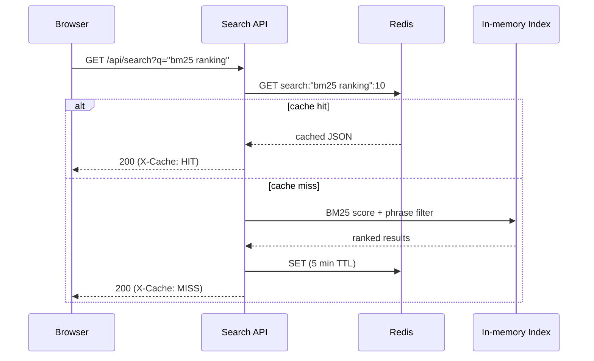

# Architecture

## Overview

The system is split into three deployable units that scale independently:

1. **Crawler workers** (`worker/`) -- stateless processes that each own a
   shard of hosts (by hashing the seed URL), fetch pages politely
   (robots.txt + crawl-delay), parse them, and append extracted documents
   to a shared sink.
2. **Search API** (`backend/`) -- loads the document dump into an
   in-memory inverted index, serves `/api/search` (BM25 + phrase search),
   `/api/stats`, `/health`, and `/metrics`, and caches query results in
   Redis.
3. **Frontend** (`frontend/`) -- a static React SPA that calls the search
   API directly from the browser.

```mermaid
flowchart LR
    subgraph Crawl Tier
        W1[Crawl Worker 0]
        W2[Crawl Worker 1]
        W3[Crawl Worker N]
    end

    Seeds[(seeds.txt)] --> W1
    Seeds --> W2
    Seeds --> W3

    W1 --> Docs[(documents.tsv\nshared volume)]
    W2 --> Docs
    W3 --> Docs

    Docs --> API[Search API\n(search_server)]
    Redis[(Redis\nresult cache)] <---> API
    API --> UI[React Frontend]
    API --> Prom[Prometheus /metrics]
    Prom --> Grafana[Grafana Dashboard]
```

## Why this shape

The crawl workers and the search API are deliberately decoupled: crawling
is I/O-bound and embarrassingly parallel across hosts, while serving
queries needs a single consistent view of the index. Rather than build a
distributed index from day one, workers write to a shared document dump
that the API node loads at startup -- simple, debuggable, and good enough
for a bounded corpus. The extension point to a live-updating distributed
index is the `LoadDocuments` / `IndexedDocument` boundary in
`backend/src/main.cc`: swap the file read for a queue consumer and the
rest of the pipeline (tokenizer, inverted index, BM25) doesn't change.

## Request flow



## Crawl politeness

Each worker caches a `RobotsPolicy` per host (scheme + host + port) the
first time it sees that host, and enforces `Crawl-delay` (falling back to
a configurable default) before each fetch to the same host. Because hosts
are sharded to a single worker by a deterministic hash, per-host state
never needs cross-worker coordination -- at the cost of uneven load if one
worker's shard happens to contain a disproportionately large host. A
production deployment would replace the static hash shard with a
Redis-backed frontier queue (`BRPOPLPUSH` for claim-with-visibility-timeout
semantics) so work rebalances dynamically; the crawl loop itself
(`Crawler::Run`) doesn't need to change, only where the frontier lives.

## Indexing & ranking

- **Tokenizer**: lowercases, strips punctuation, keeps stop words in the
  token stream (needed so a stop word can still be part of a phrase like
  `"to be or not to be"`) but excludes them from IDF-weighted scoring.
- **Inverted index**: per-term postings list with per-document body/title
  frequency and positional data (for phrase search), protected by a
  `shared_mutex` so concurrent search requests don't block each other.
- **Ranking**: BM25 with independent length normalization for title and
  body fields plus a configurable title-boost weight (`Bm25Params`) --
  approximating BM25F without needing a generalized multi-field
  implementation, since the corpus only has two fields worth weighting.
- **Phrase search**: quoted clauses (`"web crawler"`) are matched by
  intersecting sorted position lists per term and checking for
  consecutive offsets; documents that fail a phrase constraint are
  dropped from the result set regardless of their bag-of-words score.

## What's production-hardened vs. a documented extension point

| Component | Current state | Production extension |
|---|---|---|
| HTTP client (crawler) | Plain TCP, no TLS | Swap for libcurl w/ HTTPS |
| Index persistence | In-memory, loaded from a TSV dump at boot | Swap `LoadDocuments` for a real ingestion pipeline / on-disk index (e.g. segment files) |
| Crawl frontier | Local per-worker deque, static host-hash sharding | Redis-backed shared frontier queue |
| Redis client | Hand-rolled RESP, single connection | Connection pool, retry/backoff, Sentinel/Cluster awareness |
| Ranking | BM25 + phrase | Add query-independent signals (PageRank-style link analysis), learning-to-rank |
| Auth | None -- API is open | Add API keys / rate limiting at the reverse proxy |

Each of these is a clean seam in the code (see the file/class named in the
table) rather than something baked in -- the goal was to keep every layer
honest about what it does today, not to fake completeness.
